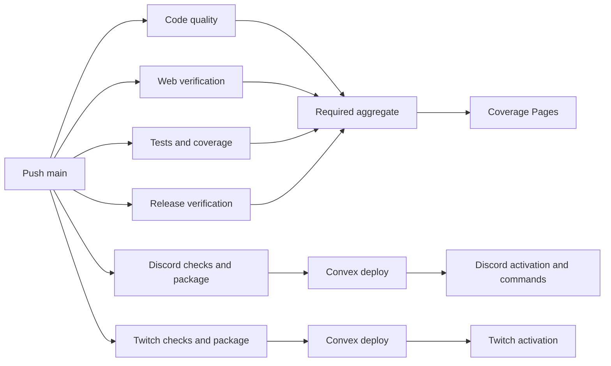
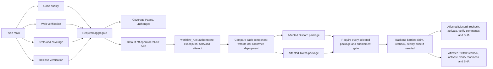

# Production release gating

JCN-206 coordinates Convex, Discord and Twitch production promotion. The four
parallel regression jobs and the required aggregate check are unchanged. Coverage
thresholds, nine workspace reports, browser/PWA checks, welcome rendering, Linux
packaging tests and failure evidence remain in the regression. The unchanged
Pages publisher is a separate sibling workflow triggered after successful main
regression, rather than a job required by the aggregate.

## Verified defect

All three workflows started on 14 October 2026 at 21:41:28 UTC for
`46bcfef43d4a01b7cf6e5e2d694667718689f3c8`.

| Hosted evidence                                                               | Production action or gate                                                                          |
| ----------------------------------------------------------------------------- | -------------------------------------------------------------------------------------------------- |
| [Regression run](https://github.com/jcodog/Cleo/actions/runs/38642179305)     | Coverage completed 21:42:36; web verification completed 21:43:10; aggregate completed 21:43:17 UTC |
| [Twitch run](https://github.com/jcodog/Cleo/actions/runs/38642179301)         | Convex deployment began 21:42:34; runtime activation began 21:42:59 UTC                            |
| [Discord run](https://github.com/jcodog/Cleo/actions/runs/38642179300)        | A second Convex deployment began 21:43:07 UTC                                                      |
| [Coverage publisher](https://github.com/jcodog/Cleo/actions/runs/38642418008) | Pages deployment began 21:43:28 UTC, after regression success                                      |

Before:

After:

The package barrier permits a skipped package only when that component was not
selected. Missing, failed, cancelled or unexpectedly skipped required packages
fail the barrier. The backend job succeeds without a deployment when no backend
changes are required. Activation requires a successful backend barrier and its
own successful package. Activation jobs use `!cancelled()` and explicit successful
dependency results, including the authorisation job. They do not use `always()`.

## Privileged workflow trust model

`workflow_run` uses the default-branch workflow context, so `github.sha` is not the
release identity. The coordinator reads source evidence from the GitHub REST API:

- Exact repository and head repository `jcodog/Cleo`.
- Workflow ID `310957278`, active workflow path `.github/workflows/regression.yml`
  and name `Regression Tests and Coverage`.
- A completed successful `push` to `main`, with a valid lowercase 40-character SHA.
- Exactly one successful completed instance of each of the four required jobs
  and `Tests, lint, typecheck, and coverage`, from that exact run, attempt and SHA.
- Current `main` still equals the selected SHA. An attempt change during promotion
  also invalidates authorisation.

The checked-out workflow policy must also match that release SHA. If a queued
manual request carries an older workflow snapshot, start a new coordinator run
on current main instead of classifying newer code with the older policy.

API failures, missing fields and inconsistent evidence fail closed. API job and
deployment history queries paginate. Manual deployment supplies the SHA,
regression run ID and explicit attempt; the same verifier applies. An unrelated
run, an old SHA, a PR, a fork or a manual regression cannot authorise a release.

If a partial rerun omits required jobs from the selected attempt, rerun all
regression jobs. Production requires a complete successful attempt.

The control job checks out `github.workflow_sha`, the trusted workflow revision,
and uploads only `production-policy.mjs`. Each consumer downloads this immutable
artifact from the current coordinator run and checks its SHA-256 against the
control job output before execution. No source-run artifact supplies privileged
code. Packages are built from the authenticated source SHA, with an explicit Git
HEAD check, frozen Bun installs, pinned Node/Bun and the existing Linux x64 probes.
Artifact names include the run and attempt; failed-job reruns consume their
original package outputs. The VPS still performs no checkout, package-manager
install or source build. Installed root-owned host tools remain unchanged.

The backend action and each runtime activation reauthenticate immediately before
calling the production command. Discord's explicit command registration also
rechecks before changing commands. Recovery registration requires evidence that
the runtime controller was actually attempted, so a rejected preflight does not
accidentally invoke recovery side effects. These checks bound the remote-ref race
to the interval between the final API read and controller invocation. GitHub does
not provide an atomic transaction between a branch update and VPS/systemd or
Convex commands. A push during an already-running irreversible command cannot
undo that command; later actions recheck and fail closed.

Only the coordinator has an automatic production trigger. Reusable manual
wrappers call it with `workflow_call`; they do not add another `workflow_run`
level. The automatic chain is regression to coordinator, one workflow-run hop.
Pages is a sibling. There are no trigger loops or dispatch-token chains.

Permissions default to empty. Authentication receives contents/actions/deployments
read access. Packages receive contents read only. Production actions receive
contents/actions read and deployments write for durable receipts. Rollback jobs
receive contents read and deployments write, with no Actions read permission.
All third-party Actions remain pinned by full commit SHA. Existing `discord-production` and
`twitch-production` environments restrict jobs to `main`. Their enablement
variables are read inside environment jobs and consumed by the package barrier.
The central backend uses the existing Discord production environment and its
Convex key. A disabled affected runtime blocks backend changes as well as runtime
activation, preventing an incompatible partial promotion.

## Classification and release receipts

The coordinator uses custom GitHub deployment tasks `cleo-backend`, `cleo-discord`
and `cleo-twitch` in the existing protected environments. These are distinct from
GitHub's normal environment deployment records. A receipt records the source run,
attempt, coordinator run, SHA and operation. Runtime receipts become successful
only after controller readiness and, for Discord, command verification succeed.

Each component compares its last successful receipt's SHA with the intended SHA
using an ancestor-checked Git diff. This covers merge commits, multi-commit pushes,
and earlier pushes that were superseded before release. It does not assume that a
workflow-run event carries push `before` metadata. Missing, failed, interrupted,
rolled-back, unavailable or non-ancestor baselines conservatively select that
component. The first coordinated release therefore selects all components.

Dashboard/landing changes keep the existing web-only configuration filtering.
The lockfile filter covers dependencies exclusive to either web application.
Discord runtime changes select Discord; Twitch runtime changes select Twitch.
Each bot's own manifest retains that runtime's scope. Root/shared lockfile
changes whose impact cannot be isolated conservatively select all components.
Backend/shared dependency changes select the backend and both compatible runtimes.
Coordinator/policy/classifier changes select all three. Service infrastructure
selects its runtime. Malformed SHA or classifier modes fail; absent config blobs
classify conservatively. Host infrastructure files still require the documented
operator installation, rather than silently updating root-owned controllers.

The entire coordinator, including manual operations, holds concurrency group
`cleo-production-promotion` with cancellation disabled. No bot workflow separately
deploys Convex. The lock spans backend deployment and both activations, so automatic
and manual releases cannot interleave. GitHub need not run queued requests in
order; every production command independently rejects a superseded SHA.
`queue: max` retains up to 100 pending runs rather than replacing a pending manual
recovery with a newer event. Classification against deployment receipts carries
forward changes that superseded requests never deployed. Queue capacity and GitHub
scheduling still apply; operators must confirm their recovery run is queued.

Before Convex is touched, a durable receipt is created and marked in progress.
A confirmed successful deployment receipt for the same SHA prevents another
deployment on duplicate events, historical reruns or manual retries. Failure, cancellation,
network loss after claiming, or a crash before confirmation leave an uncertain
receipt. The same SHA cannot automatically redeploy Convex in that state.
If the final recheck rejects authorisation before the Convex command starts, the
same shell marks only its own unused backend claim inactive, then fails. That
cleanup verifies the receipt's task, operation, SHA, source run/attempt,
coordinator ownership and unfinished state. It never clears a claim after the
deployment command starts or treats a rollback receipt as backend success.

An operator must inspect the coordinator logs and Convex history. If deployment
is proven successful, mark that exact `cleo-backend` receipt successful through
the authenticated GitHub deployments API. If it is proven that deployment never
occurred, mark it inactive to release the claim. Do not clear an uncertain claim
without evidence. This is an explicit incident reconciliation action, outside
automatic retries. The current verified main SHA can then be promoted again.

## Manual operations and recovery

- **Validate:** `Production Release`, operation `validate`, explicit current main
  SHA and selected service. The existing bot operation wrappers also validate
  their current main SHA. This runs service checks, builds and validates packages.
  It does not claim deployment receipts, change Convex, register commands, restart
  services or activate production. Production enablement may remain off.
- **Deploy:** `Production Release`, operation `deploy`, explicit current main SHA
  and a successful push regression run ID and explicit attempt for that exact SHA.
  Classification and both affected environment controls apply. Selecting a service cannot bypass
  required packages or the backend. Stale deployment is never a manual exception.
- **Rollback:** either bot's manual operations wrapper, or `Production Release`
  with operation `rollback` and exactly one service. Only a trusted main invocation
  may enter its protected environment. No arbitrary release SHA, archive, path,
  command or URL is accepted. The installed controller chooses the recorded,
  verified previous release. A rollback intent receipt invalidates the runtime
  baseline even if recovery fails. Rollback does not need successful regression,
  does not use the enablement flag, and never rolls back Convex. The shared lock
  waits for any current production action to finish before recovery starts.

Automatic reruns of the same main revision cannot undo an incident rollback.
A rollback receipt holds the main SHA observed at recovery time. A later main
revision may be promoted after its regression, or an operator can explicitly
deploy the held current main SHA with its genuinely successful regression. That
manual promotion creates a new runtime receipt and lifts the automatic hold.

Discord requires contract v5, SHA-256/manifest verification, runtime rollback and
authoritative command registration/recovery. Twitch retains contract v3, artifact
validation, EventSub/runtime readiness, persisted recovery intent, and the policy
to restore a verified prior release or stop an unhealthy service. Explicit Twitch
rollback is now available from GitHub as well as the installed operator command.
Neither workflow sends chat messages or announcements as a smoke test.

Backend success and runtime activation are separate operations. If one runtime
fails after Convex succeeds, Convex remains deployed, the affected controller
recovers or stops according to its existing policy, and the other runtime may
succeed. The run fails and summaries report the actual resulting state. Retry the
same current main through the coordinator to reuse the backend receipt and retry
outstanding runtimes. If main advanced, release its newly verified current SHA.
Backend changes must remain compatible with the runtimes still active during
promotion and incident recovery. This workflow does not claim atomic rollback of
database/schema changes and runtime releases.

## Separate Vercel production boundary

Vercel remains outside this gate. GitHub deployment record
[`7077978019`](https://api.github.com/repos/jcodog/Cleo/deployments/7077978019/statuses)
reports the landing production deployment successful at 21:42:46 UTC for the
same historical SHA, before the 21:43:17 aggregate success. The GitHub branch
ruleset does not itself demonstrate Vercel deployment gating. Treat both landing
and dashboard Vercel production as independently triggered until their project
settings and integration are explicitly audited and gated. This PR changes no
Vercel settings and does not claim platform-wide production gating.

## Commit and troubleshooting discipline

Use pull requests for normal main changes and GPG-signed conventional commits
such as `fix(release): reject stale promotion attempts`. A production-troubleshooting
commit must explain the concrete problem, intended result and validation in its
body, with an issue or release reference such as `Refs #193 / JCN-206` or a release
tag. Messages such as `x`, `temp`, `dummy` or `retry` do not explain a change.

Retry an existing workflow run or use the documented `workflow_dispatch` controls
for validation, promotion or recovery. Do not add placeholder source files or
commits merely to trigger CI or deployment. An empty commit is exceptional: use
one only when an approved process genuinely needs a new revision and rerun/dispatch
cannot satisfy it. It must follow the normal signed PR/check controls and state
why the new revision is necessary, who approved it and the issue/release reference,
for example `chore(release): record approved verification revision` with that
reason in its body. An empty commit never bypasses regression or rollout gates.

GitHub issue [#193](https://github.com/jcodog/Cleo/issues/193), mirrored as JCN-206,
is **partially addressed** by this PR and must remain open. The existing main
ruleset already requires PRs, the aggregate regression, current branches, resolved
conversations and verified signatures, and blocks force pushes/deletion. Its zero
bypass actors remain unchanged. The issue's requested emergency administrator
exception is outstanding and needs a separately approved, auditable policy and
settings decision. The manual runtime rollback controls here are not a branch
protection bypass and do not complete that requirement. Do not weaken the ruleset
or claim an exception exists.

## Settings and rollout

Ruleset `Protect main`, ID `25120348`, was read and remains unchanged, including
its required aggregate, up-to-date branches, resolved conversations, signed
commits and absent bypass actors. No new protected environments are required.
Automatic promotion now requires the deliberate repository variable change
`CLEO_PRODUCTION_AUTO_PROMOTION_ENABLED=true` after operator approval. Keep the existing Convex key in `discord-production`, bot
enablement variables, `main`-only environment policies and `cleo-prod` runner.
The runner needs outbound HTTPS to `api.github.com` for fresh eligibility reads
and receipt writes. It already downloads Actions artifacts.

The coordinator becomes available on the default branch after merge, but its
first `workflow_run` is held unless `CLEO_PRODUCTION_AUTO_PROMOTION_ENABLED` is
explicitly true. Missing, false, malformed and whitespace-padded values disable
it. The credential-free rollout job writes a clear summary and skips control,
packages, Convex, activation and command registration. Manual validation, verified
manual deployment and incident rollback retain their separate controls. The four
parallel regression jobs and Pages publisher are unaffected.

### Controlled first rollout, operator actions only

1. Merge only after this PR's required checks pass and review is complete.
2. Allow the first new main regression to complete.
3. Confirm the coordinator summary says automatic promotion is disabled and no
   production job ran. Keep the new repository variable absent or false.
4. Run `Production Release` with operation `validate` and the exact current main
   SHA, choosing both runtimes. This only tests and packages artifacts.
5. Check outbound GitHub API access, main-only protected environments, Convex key
   placement, both bot enablement variables, runner permissions and host contracts.
6. Install and verify Discord host controller contract 5 using the targeted
   [host update procedure](discord-production-deployment.md#update-the-installed-release-controller).
   Keep production operations quiescent while installing. Twitch contract 3 stays
   unchanged. Application artifacts cannot perform this host update.
7. Inspect the manual validation plan. No coordinated successful receipts means
   the first deploy conservatively includes Convex and both runtimes; later plans
   compare each component's confirmed deployment baseline. Validation does not
   create a deployment receipt or baseline.
8. Obtain operator approval and intentionally set repository variable
   `CLEO_PRODUCTION_AUTO_PROMOTION_ENABLED=true`.
9. Perform one controlled promotion. Explicit manual deploy requires the exact
   current main SHA and its complete successful push regression run ID and attempt;
   alternatively a later current-main successful push may promote automatically.
   Enabling the variable alone does not dispatch a workflow. Observe the shared
   concurrency queue and each production step.
10. Verify Convex history, both bots' readiness and actual active SHAs, Discord
    command verification, and terminal custom deployment receipts. Reconcile any
    uncertain receipt against host/Convex evidence before marking it terminal.

These are future operator instructions. This PR does not install host tools,
change the rollout flag, dispatch production, merge or verify live infrastructure.

### Credential and receipt boundaries

`GH_TOKEN` is scoped to policy API steps. Mixed recheck/mutation shells remove its
export attribute immediately, then pass it only as a command-local assignment to
the trusted policy process. Convex receives only its separately scoped deployment
key; dependency installation, builds, controllers, metadata readers and systemd
calls receive neither GitHub token nor an unrelated Convex key. The policy process
captures its API credential then removes it from its environment before spawning
Git or the classifier. No token is stored in artifacts or summaries.

Receipt updates validate task/component, operation, intended SHA, source run and
attempt, coordinator run and coordinator attempt, schema, and unfinished state.
A failed final preflight before the controller starts marks only its owned unused
claim inactive. A completed controller and all required verification permit a
terminal success; confirmed candidate failure remains failure even if the existing
controller restores a healthy previous runtime. A completed incident rollback
records success only after readiness and Discord command verification. Confirmed
rollback failure records failure. Rollback success is recovery intent for the main
revision observed when claimed, not a deploy baseline for that revision.

Cancellation, signal termination and incomplete verification preserve unfinished
receipts. An API response can also be lost after GitHub persists a terminal status.
The caller reports failure without claiming success, and a retry reads the persisted
status and rejects another completion. Unfinished uncertain outcomes are never
automatically marked successful or cleared. Inspect the persisted receipt, actual
host state and logs to reconcile them. Repeated controlled recovery creates a
separate owned intent. Failed and rollback receipts never become trusted deployment baselines;
rollback intent holds its observed main revision against historical automatic
runs regardless of terminal success or failure. The shared production lock still
covers validation, backend, both runtime activations and recovery.

## Verification evidence

Local verification passed `bun run test:ci`, `bun run test`,
`bun run test:coverage`, `bun run lint:ci`, `bun run typecheck`, and `bun run build`
with the existing public compile-only fixtures. Targeted Discord coverage and
typechecking also passed after the final classifier changes. Changed-file
Prettier checks and Bash syntax checks passed. Actionlint 1.7.12 passes with only
its obsolete rejection of `concurrency.queue` filtered. GitHub's
[concurrency documentation](https://docs.github.com/en/actions/how-tos/write-workflows/choose-when-workflows-run/control-workflow-concurrency)
supports `queue: max`; the executable workflow contract checks that exact setting.

The [first PR regression](https://github.com/jcodog/Cleo/actions/runs/38648891228)
passed Linux release verification, nine-workspace coverage and browser/PWA checks,
but failed code quality because a Discord operation fixture still extracted its
command shells from the retired workflow. The aggregate correctly failed. The
fixture now shares the coordinator extractor with the portable CI contracts, so
this stale reference is caught even on hosts that cannot run POSIX permission
fixtures. Twitch extraction is scoped to its own package job. Historical hosted regression
`38652686837` passed at `041caf6`. The subsequent
[run `38655961433`](https://github.com/jcodog/Cleo/actions/runs/38655961433)
passed all four parallel jobs and the aggregate at signed HEAD
`83fb75ab3e668c3d861b97e063440af9a03e4600`, including the security, receipt lifecycle
and contract-5 Linux recovery fixtures. The later
[run `38728605136`](https://github.com/jcodog/Cleo/actions/runs/38728605136)
also passed all five checks at signed HEAD `25ea6eb9a024365a87a8b7b87f82b723303a5f4e`.
These successes authenticate those exact
revisions only. Each later commit needs its own successful complete hosted
regression; the PR description records the latest checked SHA and run.

The new fixtures exercise 81 rejected source-evidence cases, real Git merge and
multi-commit histories, actual workflow job conditions, the actual package-barrier
shell and protected enablement flags, artifact producer/consumer names, durable
backend claims and incident holds. The verifier also accepted the real historical
run `38642179305` using its unmodified GitHub API run, workflow and job evidence.

On this Windows host, `bash .github/scripts/test-operations.sh` passed its new
Node policy tests, then rejected the POSIX permissions fixture. Both release
verification scripts correctly refused Linux packaging on `win32-x64`. The historical Linux run above executed those checks successfully alongside
Chromium/Firefox, PWA and welcome rendering evidence. Later commits still need
the same complete hosted verification. No production operation was invoked locally.

The restricted Actions condition interpreter rejects unsupported/malicious syntax
without dynamic JavaScript execution. Added fixtures execute the actual rollout,
backend and runtime shells with disposable command adapters that assert their
child environments, recheck/deployment order, preflight cleanup and signal versus
confirmed completion. Mock API fixtures verify ownership, terminal statuses, lost
confirmation and repeat recovery. These tests do not prove live VPS or Convex
execution; no new production coordinator has performed that end-to-end rollout.
